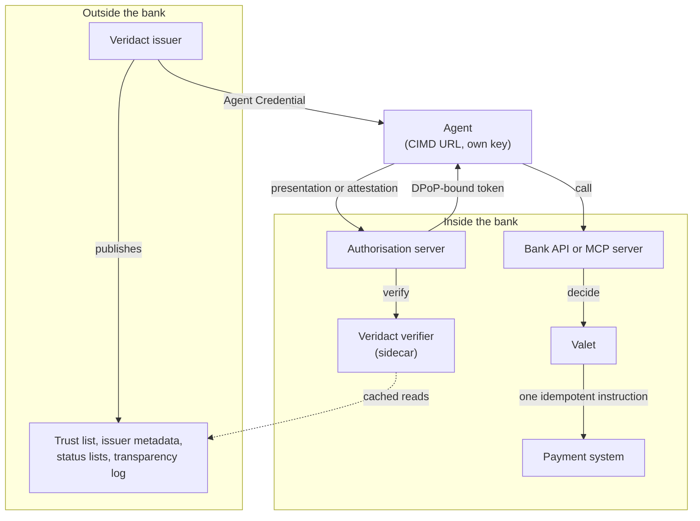

Veridact and Valet answer different questions, and each is useful without the other. Together they let a bank serve an AI agent without a shared password, knowing who answers for the agent, what its operator allowed, and what the customer allowed.

| Question | Answered by | Held where |
|---|---|---|
| Which agent is this, who operates it, and is it still trusted? | Veridact | Credentials from an accredited issuer, verified inside the bank |
| What did the customer allow? | Valet | The mandate, in the bank's own Valet deployment |
| What happened? | Valet's receipts | A signed, hash-chained record in the bank |

Veridact never holds customer identities, and Valet never decides who an operator is.

## Where each piece runs

The bank runs the verifier and Valet. Neither calls home: the verifier reads cached, signed public files, and Valet's mandates and receipts never leave the bank.

## One payment, step by step

1. **The agent gets a credential.** Its operator has delegated authority to it, within limits set by appointed approvers. The agent client renews an Agent Credential from an accredited issuer every few hours over ACME-A ([spec: Issuance protocol](/docs/veridact/spec/#issuance-protocol-acme-a)).
2. **The customer grants a mandate.** In their own bank's app, the customer chooses an access level, such as Bill payer, approved payees, limits and a grant length ([Valet profile §2 and §3](/docs/valet/profile/#2-access-levels)). The consent screen shows the operator's verified name, taken from the credential, never the name the agent gives itself.
3. **The agent proves who it is.** At the bank's authorisation server it presents its Agent Credential, by client attestation (pattern C) or token exchange (pattern A). The verifier runs its eight checks ([spec: Verification at the relying party](/docs/veridact/spec/#verification-at-the-relying-party)).
4. **The bank issues a token.** It is bound to the agent's key, names the customer as `sub` and the agent as `act.sub`, and carries the operator's limits and the Valet grant ([spec: Verification at the relying party](/docs/veridact/spec/#verification-at-the-relying-party)).
5. **The agent asks to pay.** The bank API runs Valet's check order: key proof, token, agent trust, grant status, authorisation, then the mandate ([Valet profile §4](/docs/valet/profile/#4-check-order-on-every-call)).
6. **The lower limit applies.** The operator's delegation limits and the customer's mandate both apply, and Valet holds the payment against whichever is lower.
7. **Outside the mandate, the customer decides.** If a rule stops the payment, Valet holds it and answers `approval_required` with a machine-readable reason. The customer approves that exact payment in the bank app.
8. **The bank pays, and Valet records it.** Valet sends one idempotent instruction to the bank's own payment system. Valet never executes a payment. Every decision, including refusals, writes a signed receipt.

## Mainstream assistants

Claude, ChatGPT, Gemini and Copilot connect to a bank as one OAuth client per platform and will never hold a Veridact credential. Veridact instead issues a [known-assistant entry](/docs/veridact/spec/#known-assistant-entries) about each platform. The bank uses it to admit the client, to show the verified operator name on the consent screen, and as a kill switch. Because an entry identifies a platform and never an instance, assistants in this lane stop at the Approved payer level: the customer approves every payment.

## Stopping an agent

| Path | Worst case |
|---|---|
| The bank's own denylist | The next request |
| The customer pauses or revokes the grant | The next request |
| Veridact revokes the agent or its operator | Up to 5 minutes to publish, plus up to 5 minutes of verifier cache, plus any cache the bank adds |

For an incident, the bank uses its denylist. Veridact revocation is the network-wide path, not the emergency brake.

## Read next

- [Veridact specification](/docs/veridact/spec/)
- [Where Valet fits](/docs/valet/where-valet-fits/)
- [How Valet uses Veridact for agent identity](/docs/valet/veridact-agent-identity/)
